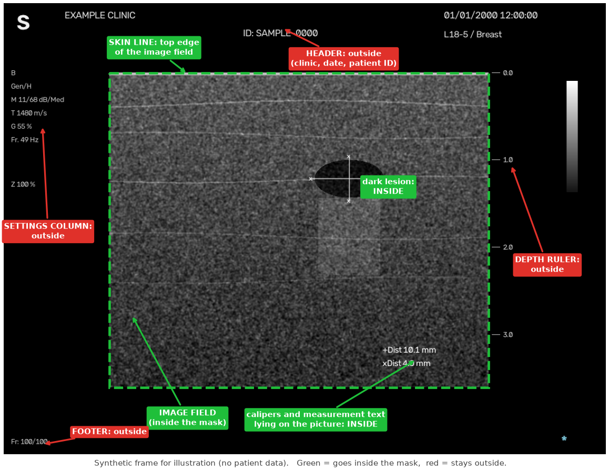
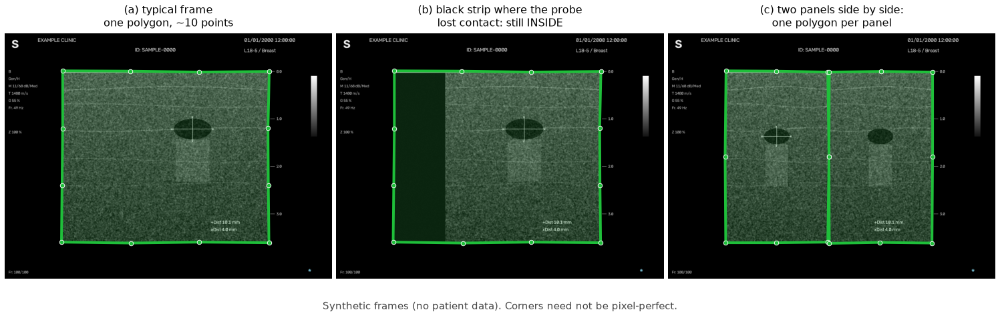
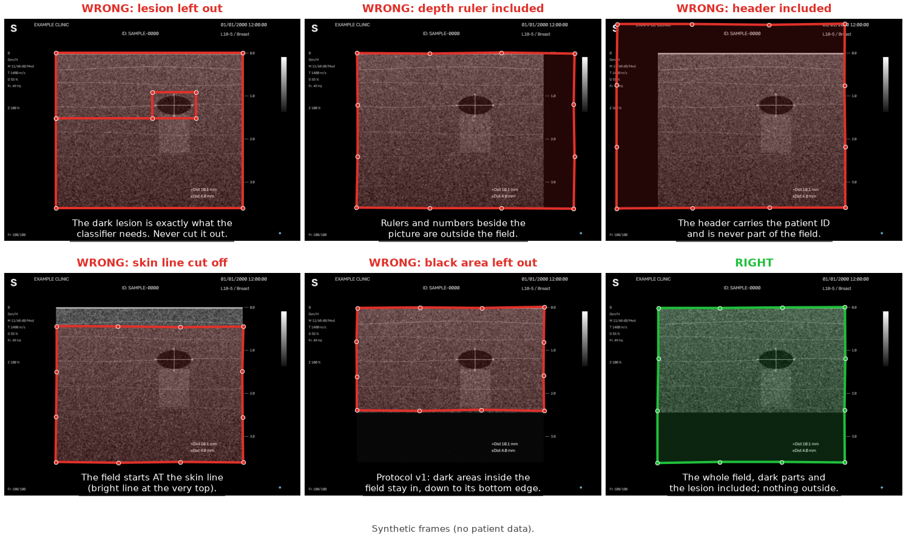

# Annotation guide: drawing reference masks (protocol v1)

This guide tells you exactly how to draw the masks that `annotate_masks.py` collects.
Read it once before you start, and keep the figure in section 3 open while you work.

**Time needed:** about one minute per frame once you have the rule in your head. Thirty
frames is a comfortable half hour.

**Why it matters:** the masks you draw are the answer key. Every accuracy number the
project reports for a new scanner or institution is a comparison against them. If two
people draw by different rules, the number measures the rules, not the software. So the
one thing that matters more than precision is that **everyone follows the same rule**.

All the example frames in this guide are synthetic (generated from random noise with
invented text). The real frames you will draw on contain patient identifiers in the
header; see [Privacy](#9-privacy).

---

## 1. Setup

You need Python with `numpy` and `opencv-python` (see `requirements.txt`). A screen and a
mouse are required: the drawing window opens on your desktop.

```bash
# 1. pick frames: one per patient, chosen at random, copied to ./annotation_work/images
python src/annotate_masks.py prepare --raw-dir /path/to/frames --n 30

# 2. draw (use your own name; every person gets a separate mask folder)
python src/annotate_masks.py draw --annotator alice
```

`prepare` is safe to run again later with a larger `--n`: it only **adds** frames and never
renumbers or overwrites the ones you already drew on.

Your masks are written to `annotation_work/masks_alice/` as black-and-white PNG files with
the same name as the frame (`m01.jpg` → `m01.png`). Progress is saved after every frame.
If you quit and start again, you continue where you stopped.

---

## 2. The rule

> **Draw one polygon around the whole image field**: the area of the screen where the
> scanner shows the ultrasound picture.

Think of it as tracing the outline of the picture itself, ignoring everything the scanner
prints around it.

| Goes **inside** the mask | Stays **outside** the mask |
|---|---|
| The whole picture, from the skin line at the top to the bottom edge of the picture | The header strip at the top (clinic name, date, patient ID) |
| **Dark parts of the picture**: lesions, vessels, cysts, shadow, a black strip where the probe lost contact | The column of settings on the left (`Gen/H`, `Z 100 %`, …) |
| Calipers (`x` marks, dotted lines) and measurement text that lie **on** the picture | The depth ruler and its numbers beside the picture |
| A colour Doppler box drawn on the picture | The grey scale bar, footer text, freeze icon |
| | Black margins of the screen around the picture |

The two rows that people get wrong are the dark parts and the header. Dark parts are
**in**, because the classifier will see them; a lesion is dark, so leaving dark areas out
would cut out exactly the thing the project is about. The header is **out**, always,
because it carries the patient identifier.



*Green labels go inside the mask, red labels stay outside. The frame is synthetic.*

### Finding the edges

- **Top.** The skin line: the bright line at the very top of the picture (depth `0.0`).
  Start your polygon on it, not below it.
- **Left and right.** Where the picture ends and the screen's black background begins. When
  part of the picture is dark, the skin line at the top usually still shows you how wide the
  field is; continue the edge straight down from there.
- **Bottom.** The lowest row where the scanner draws the picture, even if what is shown there
  is black. If the picture fades to black and you cannot see an edge, carry the left and right
  edges straight down to the level of the **last tick of the depth ruler** and close the polygon
  there. This is the one place where two careful people may differ by a few pixels; that is
  expected and is exactly what the agreement check measures.

---

## 3. Drawing one frame, step by step

1. The frame opens with the protocol reminder on top. Press **H** to hide or show it at any time.
2. If the edge of the picture is hard to see, press **T**. It boosts local contrast so dark
   edges stand out. Press **T** again to go back.
3. Click the **top-left corner** of the field, on the skin line.
4. Move **clockwise**: along the skin line, down the right edge, along the bottom, up the left
   edge. A click every 50–150 pixels is plenty; **6 to 15 points** is typical.
5. Right-click (or press **Z**) to remove the last point if you misplace one.
6. Press **ENTER** when the outline is closed. It saves and moves to the next frame. (Pressing
   ENTER with an unfinished outline closes it for you as long as it has at least three points.)

Pixel-perfect corners are not needed. A good outline is within a few pixels of the true edge.
Do not spend time on it, and do not zoom in to fix tiny errors: consistency across hundreds
of frames matters more than precision on one.



*(a) A typical frame. (b) A black strip where the probe lost contact is still inside.
(c) Two panels side by side get one polygon each.*

---

## 4. Special cases

**Two panels side by side.** Draw one polygon around each panel. Press **SPACE** after the
first to close it and begin the second. The thin divider between them does not matter.

**A black strip inside the field** (the probe lost contact on one side, or deep shadow fills the
bottom). It is part of the field, so it goes **inside**. Follow the field's outer edge, not the
edge of the bright tissue.

**A lesion, vessel or cyst.** Inside. Never cut around it.

**Calipers, `+Dist` / `xDist` text, `S` marker, biopsy guide lines lying on the picture.**
Inside, because they lie on the field. You are tracing the field's outline, not the pixels'
content.

**Colour Doppler.** The box drawn on the picture is inside. The colour **scale bar** beside the
picture is outside.

**Text that sits partly on the picture and partly beside it.** Follow the field edge and ignore
the text.

**A frame that is almost entirely black, or where you cannot tell where the picture is.** Press
**S** to skip it. Skipped frames are recorded in the log.

**A frame that is not a B-mode picture at all** (a settings screen, a report page). Press **S**.

**You are not sure.** Make your best judgement, draw it, and carry on. If many frames feel
ambiguous in the same way, that is a finding: tell whoever runs the project so the rule can be
clarified for everyone, rather than each person quietly inventing their own.

---

## 5. Common mistakes



| Mistake | Why it is a problem |
|---|---|
| Cutting the lesion out | The lesion is what the downstream classifier needs. |
| Including the depth ruler | It is not part of the field; it inflates the mask. |
| Including the header | It carries the patient identifier. |
| Starting below the skin line | Loses the top of the picture. |
| Leaving black areas out | Protocol v1 includes the whole field, dark parts too. Leaving them out makes your mask differ from everyone else's. |
| Drawing a loose outline far outside the field | Includes screen background that is not part of the picture. |

---

## 6. Keys

| Key | Action |
|---|---|
| left click | add a point |
| right click or **Z** | undo the last point |
| **SPACE** | close this polygon and start another |
| **ENTER** | save and go to the next frame |
| **T** | toggle contrast enhancement |
| **H** | show or hide the protocol reminder |
| **C** | clear everything on this frame |
| **S** | skip this frame (nothing saved) |
| **B** | go back to the previous frame |
| **Q** | quit (progress is kept) |

To redraw frames you have already finished:

```bash
python src/annotate_masks.py draw --annotator alice --redo m05,m09     # specific frames
python src/annotate_masks.py draw --annotator alice --redo all         # everything
```

---

## 7. Check your work

When you finish, or at any time:

```bash
python src/annotate_masks.py check --annotator alice --header-rows 100
```

It flags masks that are empty or tiny, cover almost the whole frame, have more than two separate
regions, have the wrong size, or **reach into the header strip**. `--header-rows` is the height
in pixels of the header on your scanner; look at one frame to choose it (about 100 for the
frames this project was developed on). Open each flagged frame and redraw it if the mask is
wrong. A flag is a prompt to look, not a verdict.

---

## 8. Two annotators: measuring agreement

One annotator gives a score with no ceiling. When the model scores 0.97, you cannot tell whether
the remaining 0.03 is the model's error or simply the ordinary disagreement between reasonable
people about an edge. Two annotators on the same frames give you that ceiling.

**Rules for the two people:**

- Both draw the **same frames**, **independently**. Do not look at each other's masks, and do not
  discuss individual frames until both have finished.
- Each uses their own `--annotator` name, so the masks are kept apart.
- Do not edit the other person's masks.

**Recommended routine**

1. **Pilot on 10 frames.** Both draw the first ten, then run:

   ```bash
   python src/annotate_masks.py agreement --a alice --b bob
   ```

2. Look at the frames with the lowest Dice. Talk about *why* you drew them differently. If the
   cause is that the written rule was unclear, **change the rule in this guide** (and bump the
   protocol version) rather than just agreeing on those ten.
3. Then draw the rest.

**Reading the number.** The agreement Dice is the ceiling for any automatic method on these
frames. A model that scores about as high as the two of you score against each other is as
consistent with a person as people are with each other; chasing more than that is chasing noise.

| Agreement Dice between people | What it suggests |
|---|---|
| 0.97 or higher | The rule is clear and edges are easy. |
| 0.93 – 0.97 | Normal. Differences are mostly at the bottom edge or a dark strip. |
| below 0.90 on many frames | The rule is not being read the same way. Fix the rule first. |

---

## 9. Privacy

The header of a real frame normally contains a patient identifier, the clinic name, and a
timestamp. Therefore:

- The frames `prepare` copies are **patient data**. Keep the work folder on your own machine.
  Do not upload it, email it, or put it in a shared repository. (The repository's `.gitignore`
  already excludes image files and the work folder.)
- `prepare` gives frames neutral names (`m01`, `m02`, …) so an identifier is not in front of
  you while you draw. The mapping back to the source frame is in `selection.csv`; it also
  holds patient folder names, so treat it as sensitive too.
- If you ever show a frame in a paper or a slide, **crop the header off first**.
- Masks alone (the black-and-white PNGs) contain no identifier, but remember that they sit
  next to the frames.

---

## 10. Where the masks go

| File | Contents |
|---|---|
| `annotation_work/images/` | the frames to draw on |
| `annotation_work/masks_<name>/` | your masks |
| `annotation_work/selection.csv` | which source frame each `mNN` is |
| `annotation_work/annotations_log.csv` | per frame: who, when, seconds taken, polygons, area |

Score the model against your masks with:

```bash
python src/evaluate_masks.py --annotator alice --model models/unet_tissue_v1.pt --constant-baseline
```

See the README for what the output means.

---

## 11. Frequently asked questions

**Do I have to draw both panels of a two-panel frame?** Yes, one polygon each.

**The picture is a fan or sector shape, not a rectangle.** Trace the outline of the fan. The
protocol is "the outline of the picture", whatever its shape.

**Should the mask follow bright tissue and skip a black corner?** No. Protocol v1 is the whole
field. Follow the field's edge, not the tissue's.

**How accurate does my outline have to be?** Within a few pixels. Six to fifteen points.

**I made a mistake on a frame I already saved.** `draw --annotator <you> --redo m07`.

**Can I take a break?** Yes. Press **Q**. Progress is saved after every frame, and the next run
resumes.

**Why one frame per patient?** Frames from one patient are near-duplicates. Using one per patient
keeps the evaluation honest: the model is never scored twice on essentially the same picture.

**Why a rule about the whole field rather than "just the tissue"?** Because the boundary of the
field is visible and two people find it in the same place, whereas the boundary between "tissue"
and "shadow" is a judgement call that varies from person to person. A rule that people apply the
same way gives numbers you can trust.
